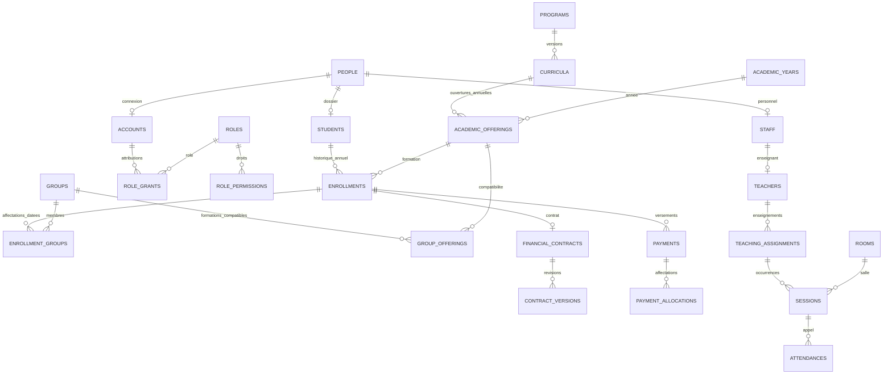

# Base relationnelle ESCEN corrigée

Date : 14 octobre 2026.

## Résultat et périmètre réel

Un nouveau modèle PostgreSQL est implémenté dans treize migrations additionnelles, isolé dans `escen` et `escen_private`. Il conserve la migration académique existante et ne supprime aucune table source. Le schéma couvre 104 tables métier et 10 tables privées de provenance, quarantaine, décisions de conception et audit.

Le modèle est déployé sur le projet Supabase `zmxapemyktxhppdxenzb` (Espace Etudiant ESCEN) : les 14 migrations, historique comprise, sont appliquées. Les 15 566 lignes source, dont 362 lignes d’identité/attributions reprises, leurs 264 diagnostics et 3 suggestions de récupération sont conservés dans le staging privé distant. Les quatre sauvegardes originales et les 139 fichiers de la dernière archive sont transférés dans Storage privé. Les profils historiques sont transformés en dossiers personnes, étudiants, comptes inactifs et attributions exactes de rôles ; les autres domaines restent dans le staging ou en revue. Aucun compte historique ne peut se connecter à Supabase Auth. L'interface métier utilise encore ses services en mémoire.

L'inventaire source de 140 tables reste une référence historique, pas le schéma cible à restaurer. Le nombre de tables ne constitue pas un critère de qualité : les nouvelles tables correspondent notamment aux relations, versions et événements que l'ancien modèle mélangeait ou ne conservait pas.

## Artefacts consultables

- [Dictionnaire des attributs et contraintes](DICTIONNAIRE_BASE_RELATIONNELLE.md), généré à partir du schéma PostgreSQL réellement exécuté.
- [Catalogue technique JSON](SCHEMA_BASE_RELATIONNELLE.json), avec tables, colonnes, FK, CHECK, exclusions, index et vues.
- [Correspondance explicite des 140 tables sources](../supabase/legacy-table-map.json). Les cibles y sont vérifiées par les tests ; leur présence ne signifie pas que les données y ont été importées.
- [Audit de départ](AUDIT_MODELE_DONNEES_ESCEN.md), avec défauts de la sauvegarde et limites du prototype.
- Migrations : `supabase/migrations/202610140001_relational_core.sql` à `202610140014_legacy_identity_import.sql`. Ces migrations sont appliquées sur Supabase ; toute évolution doit désormais passer par une nouvelle migration.

## Relations structurantes



Les inscriptions et les groupes ne sont pas déduits des textes du dossier étudiant. Le groupe n'est pas une salle. Des FK composites garantissent la concordance du groupe, de l'année, du niveau, du site et de la formation. Une matière enseignée est un élément de maquette versionné, relié à une UE et à un semestre.

## Corrections implémentées

| Domaine | Comportement du modèle corrigé |
|---|---|
| Identité | Personne distincte du compte, de l'étudiant et du personnel. Enseignant relié au personnel. Identifiants UUID immuables ; lien Auth distinct, avec FK vers `auth.users` lorsque Supabase est présent. |
| Référentiel | Formation et parcours stables, maquette versionnée, semestres, UE, éléments constitutifs, crédits, coefficients, CM/TD/TP/autres heures, pondérations et syllabus. Budgets vérifiés avant approbation ; maquette approuvée figée. |
| Inscriptions | Inscription liée à l'offre annuelle, affectations de groupe datées, événements de statut, responsables financiers et contacts. Réinscription et changement de groupe conservent les anciennes relations. |
| Planning | Série récurrente distincte de chaque occurrence, prévu/réel, remplacement et site/salle. Exclusions PostgreSQL pour les conflits de groupe, enseignant et salle. Contrôles de semestre, périodes bloquées, disponibilité et capacité lors de l'enregistrement. |
| Présences | Unicité par séance/inscription. Plusieurs présences pour un même étudiant sont possibles. Justificatifs et présences enseignants séparés. Une fermeture d'affectation ne peut pas invalider un appel historique existant. |
| Examens | Épreuve reliée à sa séance et ses candidats, salles multiples, surveillants, anonymat, sujet/version/parties/questions/options, tentatives et réponses. Les FK empêchent une réponse d'un autre sujet. Horloge serveur pour démarrage, échéance et remise ; copie remise verrouillée. |
| Notes | Valeur entre 0 et 20, précision de deux décimales vérifiée sans arrondi implicite. Absence distincte de zéro. Transitions des six états historisées ; publication directe refusée. Correction publiée par révision avec ancienne/nouvelle valeur, auteur, rôle et motif. |
| Réclamations | Sept états, événements datés, rattachement au bon candidat et à sa note. La clôture d'une correction attendue exige une révision liée. |
| Jury et relevés | Règlement versionné, jury et membres, décisions immuables, notes et versions utilisées, crédits, documents et instantanés. Une correction ultérieure signale la décision à réexaminer ; elle ne réécrit pas le relevé ancien. |
| Finance | Nature de frais, tarif, contrat, versions, lignes, remises, bourses fixes/pourcentage, échéances. Paiement, payeur, auteur, reçu, allocations, annulations, remboursements et avoirs distincts. Montants FCFA entiers. Allocations bornées par paiement, ligne et échéance, avec verrouillage des lignes concernées. |
| Logistique | Demande et lignes d'achat, réceptions partielles, équipement et mouvements de stock reliés à une réception. Réception excessive et stock négatif refusés. Dépenses distinctes des paiements étudiants. |
| Documents | Métadonnées des fichiers et chemins Storage séparés des pièces, types, exigences, versions et contrôles de conformité. Aucun contenu binaire ou data URL stocké dans les tables métier. |
| Communication et support | Communications internes, audiences explicites, lectures et pièces jointes ; tickets, messages, catégories et fichiers. Les annonces d'emploi historiques ne sont pas confondues avec les annonces internes. |
| Historique | Aucune FK en suppression cascade dans le nouveau modèle. Suppression des lignes métier refusée ; contre-opérations et versions pour les opérations sensibles. Audit avant/après, date, transaction, acteur disponible et identité de connexion PostgreSQL. |

Le `database_actor` de l'audit identifie le principal PostgreSQL. La commande serveur impose un compte applicatif actif relié à Auth et transmet son identité par contexte transactionnel, y compris pour les tables sans colonne auteur. Ce contexte est restauré après la commande et annulé avec elle en cas d'échec. Les auteurs explicites et les rôles attribués restent enregistrés ; la future couche de commandes doit vérifier les permissions métier avant d'appeler cette passerelle réservée au serveur.

## Reprise de la sauvegarde

Source principale : `sauvegarde-complete-2026-10-14_11-41-02.zip`. Les trois sauvegardes antérieures sont consultées uniquement pour suggérer des parents absents. Elles ne sont pas fusionnées.

Préparation locale effectuée :

| Catégorie | Lignes |
|---|---:|
| Sources conservées au total | 15 566 |
| En attente de transformation/revue | 11 396 |
| Archives hors périmètre ou état technique ancien | 3 930 |
| Isolées pour anomalies ou doublons | 240 |

Les 240 lignes portent 264 diagnostics : certaines ont plusieurs problèmes. La reprise étendue ajoute notamment 88 attributions `role_user` dont le parent `users` est absent, après prise en compte du type polymorphe. Les identifiants étudiants ne sont pas comparés par erreur à ceux des comptes.

Trois lignes parentes candidates ont été retrouvées dans les sauvegardes anciennes, avec leur provenance et empreinte SQL. Elles ne suffisent pas à résoudre tous les orphelins et n'ont pas été réintroduites automatiquement. Un identifiant égal entre deux tables différentes ne prouve pas l'identité d'une personne.

Les fichiers de travail sont sous `.tmp/legacy-database/`, avec accès local restreint, empreintes SHA-256 et données sensibles de connexion masquées. Le ZIP original conserve les données source intactes. Les données de candidats et autres domaines exclus restent en archive/revue, sans création d'un module d'admission.

Le chargement local de référence est sous `.tmp/relational-database-20261014-final/`. Il crée les tables corrigées et charge les sources dans `escen_private.legacy_rows`, leurs diagnostics dans `import_issues` et les suggestions dans `recovery_candidates`. Les tables métier contiennent uniquement les référentiels de rôles/permissions, pas les dossiers historiques : aucun rapprochement ambigu n'est présenté comme terminé.

## Commandes reproductibles

```sh
npm run test:db
npm run test:legacy
npm run db:describe

python3 scripts/prepare-legacy-data.py \
  --archive "$HOME/Downloads/Sauvegardes-ESCEN/sauvegarde-complete-2026-10-14_11-41-02.zip" \
  --older "$HOME/Downloads/Sauvegardes-ESCEN/sauvegarde-bdd-2026-08-27_16-37-27.sql" \
    "$HOME/Downloads/Sauvegardes-ESCEN/sauvegarde-complete-2026-09-29_22-19-14.zip" \
    "$HOME/Downloads/Sauvegardes-ESCEN/sauvegarde-complete-2026-10-14_11-40-03.zip"

npm run db:stage -- --db-dir .tmp/relational-database-nouvelle-revue
```

Le chargeur refuse une destination existante. Il utilise PostgreSQL local en mémoire ou sur disque via une dépendance de développement ; aucun port réseau, URL de base distante ou secret Supabase n'est requis. Le chargement des sources est transactionnel et contrôle la conservation des lignes et diagnostics. Les empreintes des fichiers de staging sont vérifiées avant chargement.

## Décisions encore nécessaires

Le schéma reste fermé aux clients applicatifs par RLS, sans policy permissive. Le catalogue de 14 rôles et 42 permissions ne crée aucune attribution utilisateur. L'ancienne lecture publique du socle académique est également bloquée par une nouvelle policy restrictive, sans modifier la migration historique.

Les décisions suivantes sont conservées comme questions ouvertes dans `escen_private.model_decisions` :

- Une ou plusieurs formations par étudiant et année ; un rôle ou cumul de rôles ; un ou plusieurs groupes simultanés.
- Nombre de tentatives et reprises d'examen ; traitement des absences et dispenses.
- Conditions et cumul des bourses ; règles de capitalisation des crédits en redoublement.
- Rattachement aux sites ; résolution des parents absents et reprise des identités historiques.

Le modèle permet de représenter ces situations sans perdre l'historique. Il ne transforme pas cette capacité technique en une autorisation métier automatique. Les automatismes d'admission, de passage et de diplôme doivent être raccordés au règlement validé, pas déduits du schéma.

Avant la reprise étendue, il reste à vérifier l’identité du premier accès de direction, traiter les anomalies, transformer les dossiers académiques, financiers et opérationnels, puis connecter les services de l’interface. Les fichiers Storage sont transférés ; leur association aux dossiers normalisés reste à établir avec les correspondances source/cible. Les dates manquantes de l'année 2023-2024, deux périodes hors de leur année et les 18 UV sans coefficient empêchent une transformation complète sans décision métier.

## Vérification

Déploiement du 14 octobre : les 14 migrations sont confirmées en base distante, avec 104 tables métier et 10 tables privées, toutes sous RLS. Le catalogue contient 14 rôles et 42 permissions. La vérification distante confirme 15 566 lignes source, 264 diagnostics, 3 suggestions et 175 comptes métier historiques désactivés; aucun compte authentifiable n’est lié à Auth. Les quatre RPC serveur refusent explicitement les appels avec la clé anonyme (`42501`). Tous les comptes importés restent inactifs jusqu’à leur vérification et liaison Auth. Les métadonnées CLI et les fichiers de reprise sont ignorés par Git ; les secrets locaux sont dans `.env.local` avec permissions restreintes.

`npm run test:db` exécute les migrations historiques et nouvelles dans un vrai moteur PostgreSQL local, avec 23 groupes de contrôles. Ils couvrent présences multiples, FK composites, contexte annuel, maquettes figées, Auth, conflits, notes/absences, examen et horloge serveur, réclamation, versions financières, contre-opérations, jury/relevé, stock, provenance, audit, RLS et refus de suppression. Ce résultat ne constitue pas une validation des policies d'accès futures ni de toutes les règles institutionnelles.

La dépendance ajoutée est `@electric-sql/pglite` en développement uniquement. `npm run test` inclut les contrôles PostgreSQL ; `npm run test:legacy` vérifie le parseur Python. Les tests du prototype, le lint et le build sont également exécutés avant livraison.


## Stockage privé et passerelle serveur

`escen-backups` conserve les quatre archives originales, sans nettoyage de leur contenu. Les fichiers dépassant 8 Mio sont découpés en parties avec manifeste, taille et SHA-256 du fichier entier et de chaque partie. La restauration concatène les parties dans l'ordre du manifeste. `escen-legacy-files` conserve les 139 fichiers extraits de la dernière sauvegarde. Les métadonnées sont immuables dans `escen_private.archive_objects`. Les scripts refusent d'écraser un objet dont l'empreinte diffère.

- `scripts/push-legacy-stage.mjs` conserve les sources préparées dans le staging distant, puis contrôle les effectifs.
- `scripts/upload-legacy-archives.mjs` téléverse les archives et fichiers dans les buckets privés.
- `scripts/verify-remote-database.mjs` vérifie le schéma distant, les effectifs et les refus RPC anonymes.
- `scripts/prepare-legacy-identities.mjs` prépare des profils sûrs et des correspondances exactes, sans mots de passe ni jetons. `scripts/import-legacy-identities.mjs` les importe dans une seule transaction avec comptes désactivés et provenance. `scripts/verify-remote-storage.mjs` relit les objets, reconstitue les sauvegardes en flux et vérifie les empreintes et les refus anonymes.

Les scripts utilisent la liaison CLI existante et les clés locales ; ne jamais journaliser les fichiers privés sous `.tmp/` ni les secrets. Les rapports de contrôle sont conservés sous `.tmp/legacy-database/`.

Les nouvelles routes `/api/session`, `/api/campus` et `/api/reprise` exigent un JWT vérifié par Supabase Auth et un compte ESCEN actif. Le rôle demandé doit être réellement attribué et actif ; ses permissions sont l'intersection du catalogue SQL et des règles de l'application. Les profils étudiant et enseignant sont obligatoires pour ces rôles. Les lectures académiques sont filtrées par identité, affectation, groupe et périmètre ; les notes non publiées ne sont pas rendues aux étudiants. Les sujets et corrigés nécessitent un futur service d'examen dédié et ne sont pas divulgués par la lecture générique. Les communications nécessitent leur service de publication/audience dédié.

La clé serveur est isolée dans un module `server-only`. Les RPC ne sont exécutables que par `service_role` et ne donnent pas d'accès SQL direct aux clients. La passerelle transactionnelle SQL teste l'atomicité, les contraintes, l'auteur et la concurrence par révision ; elle ne remplace pas les autorisations métier. Le POST générique `/api/campus` refuse donc les écritures (`501`) jusqu'au portage des commandes par domaine. Ces routes sont une fondation testée, pas une annonce de persistance complète des écrans existants.


Contrôle Storage final du 14 octobre à 14 h 16 UTC : les 143 objets logiques (4 sauvegardes et 139 fichiers) ont été relus. Les quatre sauvegardes sont reconstituables avec leur SHA-256 original ; les empreintes et tailles de tous les fichiers sont correctes. L'accès sans authentification est refusé pour chaque objet contrôlé. Le volume source transféré est de 296 131 603 octets, hors manifestes de découpage. Ce contrôle ne prouve pas encore l'association de chaque document à son dossier métier normalisé.


## Comptes historiques dans la sauvegarde

La sauvegarde couvre bien les comptes. Elle contient 30 lignes `users`, 145 lignes `etudiants`, 268 attributions polymorphes `role_user` et 851 anciens jetons `personal_access_tokens`. Les mots de passe, jetons de rappel et jetons d’accès ont été retirés des exports de travail ; les archives originales restent privées et intactes.

La migration normalisée reprend les 30 utilisateurs et les 145 étudiants comme 175 personnes distinctes ; les identifiants utilisateur et étudiant n’ont aucune correspondance exacte d’email ou de matricule entre leurs tables. Elle crée 175 dossiers de compte avec `active=false` et `auth_user_id=NULL`, ainsi que les 145 fiches étudiant. Elle conserve les 176 attributions dont le parent et le rôle source sont présents et dont le slug correspond exactement à l’un des 11 rôles ESCEN reconnus. Les rôles multiples présents dans le dump sont conservés avec leur provenance.

Les 92 autres attributions de rôle restent en staging/revue faute de correspondance sûre du parent ou du rôle source. Quatre étudiants portent le statut source `bloque` ; tous les comptes importés sont de toute façon désactivés. Les emails source n’étaient vérifiés pour aucun des 175 profils : ils ne sont pas liés automatiquement à Supabase Auth et ne permettent pas de réutiliser les anciens identifiants.

La migration ajoute une piste d’import distincte des validations humaines : elle enregistre le lot, l’exécution, le principal PostgreSQL, les effectifs, les correspondances source exactes et la provenance des rôles historiques dont l’auteur original est inconnu. Les validations humaines continuent d’exiger un compte ESCEN. Le script de reprise des identités est déterministe, vérifié localement et refuse une seconde exécution. Il crée les comptes désactivés, sans lier automatiquement les emails non vérifiés à Auth.
