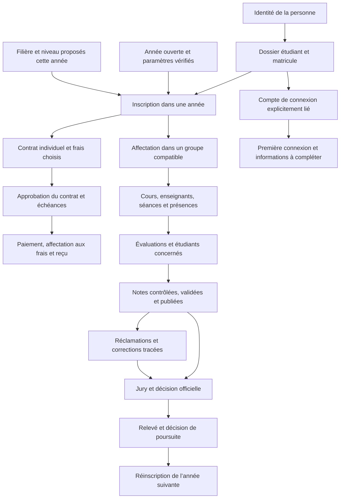

# Revue des interconnexions métier ESCEN

15 octobre 2026. Revue du code local, des migrations, des parcours et de leurs tests. Elle complète `REVUE_CYCLE_ANNEE_SCOLAIRE.md`. Elle ne certifie pas les données distantes, les permissions réellement attribuées à chaque compte, ni l’achèvement des workflows. Aucune donnée réelle n’a été modifiée.

## Conclusion

Les principales relations existent dans le schéma, avec des protections utiles, mais la continuité des opérations n’est pas achevée. L’application peut consulter plusieurs étapes d’un parcours sans permettre d’enregistrer la décision nécessaire pour passer à la suivante. Un menu disponible ou une table présente ne signifie pas que le processus métier est opérationnel.

La cible est un parcours lisible depuis un dossier étudiant et une inscription annuelle confirmée : qui intervient, ce qui manque, quelle décision est nécessaire, quelle écriture sera effectuée, et quel sera son effet dans les autres modules. Les anomalies de reprise doivent rester distinguées des tâches ordinaires.

## Ce qu’il faut relier

Ce schéma décrit les liaisons métier à terminer, pas une certification de leur disponibilité actuelle. Les règlements ne deviennent pas une condition d’accès aux cours, aux notes ou au diplôme sans règle institutionnelle explicite.

## Constats vérifiés et priorités

| Réf. | Priorité | Liaison | Constat précis | Conséquence et correction à réaliser |
|---|---|---|---|---|
| INT-01 | Critique | Année → opérations | Plusieurs années ouvertes restent autorisées par le cycle SQL ; l’utilisateur impose une seule année ouverte. | Sécuriser l’unicité et la concurrence en base et sur le serveur. Ne pas réaffecter arbitrairement une année existante. |
| INT-02 | Critique | Clôture → nouvelle année | La désignation de travail doit être retirée avant clôture, mais son retrait n’est pas proposé dans l’écran. | Construire une transition complète sans obligation d’ouvrir une deuxième année. |
| INT-03 | Critique | Scolarité → finance → inscription | La route d’inscription exige `student.lifecycle.manage` et `payment.record`. L’inventaire du catalogue des rôles ne trouve que l’Informaticien réunissant les deux. | Distinguer les tâches de scolarité et de finance avec un parcours de validation. Ne pas accorder le droit d’encaisser à tous les gestionnaires pour contourner le problème. |
| INT-04 | Critique | Jury → passage → réinscription | Le serveur refuse tout changement de niveau ou de filière lors de la réinscription. Il n’exploite pas encore de décision officielle autorisant cette poursuite. | Relier une décision persistante à la cible autorisée de réinscription, avec auteur, motif et historique. Les règles de passage restent institutionnelles. |
| INT-05 | Haute | Inscription → contrat utilisable | L’inscription crée un contrat et des lignes en brouillon. Le parcours connecté complet d’approbation, échéancier et affectation des règlements n’est pas livré dans cette commande. | Terminer cette chaîne ; distinguer contrat préparé et contrat approuvé dans le dossier et les actions possibles. |
| INT-06 | Haute | Paiement → dette → reçu | La commande du dossier enregistre paiement et reçu ensemble, mais ne construit pas d’affectation à une ligne de contrat ou une échéance. | Ne pas confondre total des versements et règlement précis d’une dette. Définir les règles d’affectation, d’avance, de trop-perçu et d’annulation avant de les automatiser. |
| INT-07 | Haute | Étudiant → première connexion | Le changement obligatoire du mot de passe existe ; la collecte et validation des informations personnelles à la première connexion ne sont pas implémentées. | Ajouter un parcours étudiant limité à ses données autorisées. Ne pas bloquer la reprise ou l’inscription au seul motif que les informations civiles sont incomplètes. |
| INT-08 | Haute | Paramètres annuels → inscription individuelle | L’inscription appelle le contrôle complet de préparation de toute l’année, pas uniquement celui de la formation choisie. | Une nouvelle formation incomplète peut bloquer les inscriptions dans une autre formation déjà prête. Séparer le bilan global d’ouverture et les prérequis de l’opération individuelle. |
| INT-09 | Haute | Références actives → groupe proposé | Constat initial corrigé pendant cette revue : les groupes et rattachements archivés pouvaient être proposés. Le même contrôle de disponibilité, d’année et de niveau est maintenant utilisé à la lecture et à l’écriture. | Correction couverte par `enrollmentGroupReferenceService.test.ts` : groupe partagé valide conservé, groupe/rattachement/formation archivés et relations absentes ou incompatibles refusés. Une relecture courante précède la confirmation serveur. |
| INT-10 | Haute | Source historique → parcours courant | Certains traitements reposent sur les données canoniques, d’autres sur les archives exactes. Une filière ou inscription absente ne peut être déduite du libellé d’un groupe. | Présenter une tâche de reprise avec preuve source et responsable, distincte d’une inscription ordinaire. Conserver les sources et signaler les relations manquantes. |
| INT-11 | Haute | Examens → résultats persistants | Des tables et protections existent. Les écrans connectés d’évaluations et résultats sont principalement des consultations ; les anciennes commandes `runWorkflow` sont refusées avec une session réelle. | Porter les commandes métier autorisées au serveur ; tester le parcours réel depuis une évaluation jusqu’à sa publication et sa correction. |
| INT-12 | Haute | Groupe partagé → enseignements | Un groupe peut accueillir plusieurs filières au même niveau. Cela ne prouve pas que toutes leurs matières, évaluations et coefficients soient communs. | Garder la formation de chaque inscription. Définir explicitement les enseignements communs et ceux propres à une filière ; ne pas donner toutes les évaluations du groupe à tous ses étudiants. |
| INT-13 | Haute | Situation scolaire → opérations autorisées | L’inscription expose des changements de statut, mais il n’existe pas de politique centrale complète par opération, état annuel et état étudiant. | Formaliser les effets d’une suspension, d’un abandon, d’une reprise et d’une fin de formation. Chaque blocage doit indiquer son motif, son responsable et les actions autorisées. |
| INT-14 | Haute | Clôture → tous les domaines | Les vérifications finales portent aujourd’hui sur trois catégories de dossiers. Communication, support et achats ne suivent pas tous le même verrou annuel. | Une matrice explicite doit couvrir chaque domaine et les exceptions après clôture. Un statut global ne suffit pas. |
| INT-15 | Haute | Écriture → reprise après erreur | La révision globale et la transaction préviennent beaucoup de doublons ou d’écritures partielles, mais ne constituent pas une identification métier de la demande lors d’une perte réseau après validation. | Prévoir un identifiant de demande et une relecture du résultat confirmé. Éviter de demander à l’utilisateur de recommencer une opération peut-être déjà enregistrée. |
| INT-16 | Moyenne | Concurrence entre modules | La révision globale de la plateforme peut rendre obsolète un formulaire à cause d’une écriture sans rapport dans un autre domaine. | Mesurer ces conflits ; prévoir des contrôles de concurrence plus ciblés, sans supprimer les contraintes transactionnelles. |
| INT-17 | Moyenne | Dossier → prochaine action | Le dossier réunit identité, parcours, finance, notes et pièces, mais ne présente pas une liste unifiée de tâches fondée sur toutes les relations confirmées. | Afficher « inscription absente », « contrat à approuver », « décision de passage attendue », etc., avec accès direct au bon contexte. Ne pas fabriquer un score de dossier complet. |
| INT-18 | Moyenne | Documents → décisions → accès | Le contexte étudiant est exigé sur les écrans concernés, mais le dépôt, la vérification, l’émission officielle et la correction n’ont pas tous un parcours connecté complet. | Définir type, propriétaire, année, inscription éventuelle, statut de vérification, droits et historique de chaque document. |
| INT-19 | Moyenne | Site connecté → inscription officielle | Un dossier reçu est volontairement distinct d’une inscription académique et d’un compte. La réception ne doit jamais être présentée comme une inscription terminée. | Afficher les étapes et le lien explicite vers un dossier existant uniquement lorsqu’il est confirmé. Aucun CRM ni nouveau parcours d’admission n’est ajouté à cette revue. |
| INT-20 | Moyenne | Comptes → personne → inscription | Le compte de connexion, le dossier civil et l’inscription annuelle sont des objets distincts ; l’inscription ne crée pas de compte Auth. | Prévoir activation, première connexion, retrait d’accès et suivi des liens sans confondre compte inactif, dossier incomplet et absence d’inscription. |
| INT-21 | Moyenne | Reporting → faits métier | Compter des personnes, inscriptions, contrats, paiements ou dossiers reçus ne mesure pas la même chose. | Chaque indicateur doit préciser sa population, son année, les états retenus et les montants non établis. Tester les annulations et paiements en attente. |
| INT-22 | Moyenne | Tests → exploitation | Les scénarios navigateur emploient des API isolées et des comptes de test. Leur réussite ne valide pas la continuité du serveur réel avec les rôles et données distants. | Conserver ces tests, puis ajouter une recette connectée dédiée sur données de test isolées, sans utiliser les dossiers réels comme terrain d’essai. |

## Points déjà solides à conserver

- Contrôles d’identité et de rôle côté serveur, avec intersection des droits du catalogue et des permissions effectivement attribuées.
- Rattachement annuel par relations réelles, conservation des années passées et filtrage des données accessibles.
- Création atomique de l’inscription, du groupe et du contrat en brouillon ; paiement et reçu enregistrés ensemble dans la commande dédiée.
- Contraintes de cohérence entre groupe, niveau et formation ; plusieurs filières possibles dans un groupe.
- Protection des historiques, corrections de notes tracées, annulations financières distinctes des transactions originales.
- Distinction des montants inconnus et du zéro ; paiements en attente exclus des montants payés.
- Protection des sources historiques et interdiction des écritures de démonstration dans une session réelle.

## Organisation cible : le dossier et ses opérations

### Dossier permanent

Une personne, son matricule étudiant, ses coordonnées, ses contacts et ses accès. Les informations manquantes demandées à la première connexion sont une tâche de complétion ; leur liste obligatoire et les champs modifiables par l’étudiant restent à préciser. L’étudiant ne modifie pas lui-même ses inscriptions, notes, paiements ou décisions.

### Dossier annuel

Une inscription identifiée, une filière, un niveau, un mode de formation et un historique d’affectation. Tous les cours, évaluations, décisions et frais doivent rejoindre cette inscription ou une référence annuelle confirmée. L’écran doit toujours dire quelle année et quelle inscription sont concernées.

### Situation académique et financière séparée

Présenter distinctement la scolarité, le résultat académique, le contrat, les versements et leurs affectations. « Payé » n’équivaut pas à « inscrit », « admis », « réinscrit » ou « diplômé ». Un dossier civil incomplet ne crée pas un impayé ni une interdiction automatique d’inscription.

### Tâches motivées

Chaque tâche doit contenir le dossier et l’année concernés, le problème constaté, les références sources, le rôle compétent, les opérations permises et la condition de résolution. L’utilisateur voit ce qu’il peut faire et ce qui nécessite un autre service, sans attribution automatique de droits supplémentaires.

### Décisions et commandes

Les transitions importantes sont des commandes métier contrôlées, pas des changements libres de champs : inscription, affectation, approbation du contrat, encaissement, publication, décision de jury, réinscription, suspension et clôture. Chaque commande valide ses relations, sa permission, son état de départ, ses conséquences et son atomicité.

## Références externes et adaptation proposée

Sources officielles consultées le 15 octobre 2026. Elles inspirent l’organisation, sans imposer les règles d’une autre institution à ESCEN.

1. [Frappe Education — inscription dans un programme](https://docs.frappe.io/education/program-enrollment) : distingue le dossier étudiant de son inscription à une formation et une période ; relie les cours et les frais. Pour ESCEN : prendre l’inscription annuelle comme contexte des opérations, sans rendre obligatoires toutes les informations civiles.
2. [PeopleSoft — activation pour une période](https://docs.oracle.com/en/applications/peoplesoft/campus-solutions/9.2.038/student-records/term-activation.html) : vérifie les conditions d’accès aux opérations d’inscription et de calcul des frais. Pour ESCEN : donner une réponse vérifiable à « cet étudiant est-il autorisé à réaliser cette opération cette année ? », sans importer leur organisation en périodes ni leur modèle de multi-inscription.
3. [PeopleSoft — gestion de la période d’un étudiant](https://docs.oracle.com/en/applications/peoplesoft/campus-solutions/9.2.039/student-records/using-term-activation-component.html) : sépare l’éligibilité à l’inscription et les informations utiles à la facturation. Pour ESCEN : des états et responsabilités distincts plutôt qu’un seul statut étudiant censé tout exprimer.
4. [Frappe Education — préparation des évaluations](https://docs.frappe.io/education/assessment_plan) : relie groupe, enseignement et période d’évaluation. Pour ESCEN : fixer explicitement les étudiants concernés par une évaluation à partir de leurs relations pédagogiques confirmées.
5. [Frappe Education — paramètres](https://docs.frappe.io/education/education-settings) : documente les paramètres transversaux de l’année, la validation des groupes et la création des comptes. Pour ESCEN : une configuration centrale dont les conséquences sont connues, avec activation des accès distincte de l’inscription et contrôles serveur.

## Ordre de réalisation proposé

1. **Sécuriser l’année et les règles communes.** Unicité, transition cohérente, bilan vérifiable et matrice d’opérations. La coexistence d’une ancienne année en finalisation et d’une nouvelle ouverte reste une décision institutionnelle non tranchée.
2. **Terminer le parcours d’inscription.** Responsabilités scolarité/finance, références actives, contrat préparé puis approuvé, dossier incomplet accepté selon l’instruction utilisateur.
3. **Terminer le parcours résultat → décision → réinscription.** Notes persistantes, jury, décision de poursuite, cibles autorisées et conservation de l’historique.
4. **Terminer la chaîne financière.** Approbation, échéances, affectations, reçus, annulations et recouvrement ancien, selon les règles institutionnelles retenues.
5. **Compléter l’espace étudiant.** Première connexion, données personnelles autorisées, pièces, résultats publiés et suivi de demandes.
6. **Relier les domaines transversaux.** Documents officiels, communication, support, achats, stock, site et reporting, avec les mêmes règles d’année, de droits et d’audit.

Pour chaque lot : un parcours complet, un responsable métier, des prérequis visibles, des commandes persistantes, un résultat vérifiable et des tests des échecs. Aucun lot ne doit afficher comme disponible une opération qui termine sur une ancienne commande de démonstration.

## Recette de parcours à viser

- Nouveau dossier avec informations civiles manquantes → inscription dans l’année ouverte → groupe → contrat préparé → approbation par le service compétent → versement affecté → reçu.
- Étudiant existant → cours réellement suivis → évaluation → notes publiées → réclamation éventuelle → correction historisée → jury → décision → réinscription dans la cible autorisée.
- Suspension ou abandon → effets explicitement définis sur opérations futures → reprise justifiée, sans effacement de l’historique.
- Paiement en attente, paiement confirmé, paiement annulé, dette antérieure et montant inconnu : affichages et calculs distincts.
- Groupe partagé entre filières → matières propres et communes → population correcte pour chaque évaluation.
- Première connexion → complétion des champs autorisés → contrôle de ses seules données ; aucune modification des données académiques par ce formulaire.
- Dernière opération sur l’ancienne année → bilan de clôture → refus motivé ou clôture autorisée → ouverture unique de la suivante selon la règle institutionnelle confirmée.
- Deux utilisateurs concurrents, perte réseau après validation, changement d’année pendant un formulaire et reprise après erreur : aucun doublon et aucune opération partielle.

## Inventaire reproductible et limites

`node scripts/review-business-connections.cjs` produit `.tmp/business-review/connections.json`. Le rapport contient les 41 routes du portail, les 22 fichiers de routes API recensés, une matrice des exigences de rôle de quatre opérations centrales et les permissions littérales déclarées dans les fichiers API.

Il s’agit d’un inventaire statique. Une permission déclarée dans un fichier ne prouve pas à elle seule l’autorisation d’une méthode ; des contrôles peuvent être indirects ou dynamiques. Les comptes effectifs et les droits SQL restent à vérifier séparément.

Contrôles complémentaires utilisés : `npm run test`, et les suites navigateur `business-processes.spec.ts`, `document-context.spec.ts`, `reenrollment.spec.ts`. Leur résultat doit être rapporté avec leur périmètre : API isolées pour le navigateur et PostgreSQL local pour les migrations.

## Fichiers permettant de vérifier les constats

- `src/app/api/enrollments/route.ts` : droits cumulés, préparation globale, décision de passage non consommée, création du contrat en brouillon.
- `src/components/modules/EnrollmentDialog.tsx` et `StudentOperationsPanel.tsx` : prérequis et actions offertes depuis le dossier.
- `src/app/api/students/[matricule]/operations/route.ts` : statuts, versements et reçus ; absence d’affectation aux lignes/échéances dans cette commande.
- `src/app/api/students/[matricule]/route.ts`, `StudentProfilePanel.tsx`, `src/server/auth.ts` : modification des données civiles et premier changement de mot de passe.
- `src/components/modules/StudentRecordPanel.tsx` et `ConnectedDomainWorkspace.tsx` : contexte du dossier et continuité des consultations.
- `src/components/modules/academic/NativeAssessmentWorkspace.tsx` : consultation des évaluations.
- `src/hooks/useAppState.ts` : refus de `runWorkflow` en session réelle.
- `src/permissions/rolePermissions.ts` et `src/app/api/session/route.ts` : catalogue des rôles et intersection des droits effectifs.
- Migrations 23, 24, 27 et 29 : cycle annuel, rattachements, préparation et reprise opérationnelle.

Le contrôle des groupes disponibles est exécuté par `npm run test`, via `src/services/enrollmentGroupReferenceService.test.ts`. L’inventaire statique peut être régénéré sans aucun accès distant.
