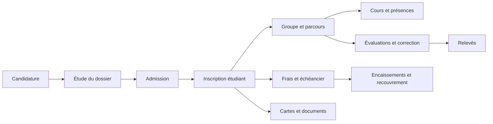

# Audit fonctionnel authentifié — ESCEN / Neo EduManager

Date : 4 octobre 2026. Application : https://escendemo.neostart.tech/

## Verdict

L’application dispose d’un périmètre fonctionnel large et plusieurs modules exploitent des données fournies par l’API : scolarité, candidatures, évaluations, finances, communication et administration. Elle présente cependant un niveau d’achèvement hétérogène. Des écrans fonctionnels coexistent avec des écrans alimentés par des listes codées en dur, des endpoints absents et des erreurs serveur masquées par des états vides.

La priorité est de fiabiliser les connexions frontend/backend, les parcours et les définitions des indicateurs avant d’élargir le périmètre ou de refaire l’interface.

## Périmètre et méthode

Connexion réalisée avec le compte fourni. Son rôle effectif est « Informaticien » : l’écran des permissions affiche 221 permissions accordées sur 221 disponibles, réparties dans 97 domaines.

Ont été parcourus : 53 écrans de navigation principale, 28 routes supplémentaires, ainsi que les fiches, formulaires, onglets et variantes de filtres. Le relevé des trois premières passes contient 91 chemins affichés distincts, y compris des fiches et formulaires. Une passe finale a reproduit les erreurs API et vérifié des parcours ciblés. La largeur mobile a été examinée à 390 px.

Les observations reposent sur le navigateur, le DOM, les requêtes réseau et, pour vérifier les écrans de démonstration, les modules JavaScript publics correspondants. Une page qui s’affiche n’est pas considérée comme entièrement validée : affichage, lecture, filtrage et enregistrement sont distingués.

Aucune inscription, modification de notes, validation d’admission, création de paiement, publication, notification par email ou suppression n’a été volontairement exécutée. L’application enregistre elle-même certaines consultations dans son journal. Les actions d’enregistrement, les exports générés et le fonctionnement propre à chaque autre rôle restent à tester dans un environnement de recette.

## Fonctionnement métier observé

Cette carte résume les liens métier proposés par les écrans. Les transitions qui enregistrent une action restent à valider en recette.

### 1. Candidature et admission

Le guichet administratif propose un formulaire en cinq étapes : identité, contact, parcours, documents et tuteurs. La configuration permet d’adapter certains champs obligatoires, les diplômes, les documents attendus et les moyens de connaissance de l’établissement.

Le parcours distingue les brouillons incomplets des dossiers soumis. L’étude présente les états « En étude », « À l’académie », « À corriger », « Validé » et « Rejeté ». La fiche candidat rassemble le profil civil, le parcours, les garanties/parents et les pièces jointes, avec des actions de transmission ou de rectification.

Les candidats admis apparaissent dans une liste séparée. L’action « Inscrire » est proposée pour ceux qui ne sont pas encore étudiants ; un dossier déjà converti affiche « Déjà inscrit ». L’affectation des groupes et la réinscription disposent d’écrans spécifiques.

Deux modes de sélection sont prévus : sur dossier, ou par concours écrit. Les sessions, matières et coefficients du concours sont configurables. Les pages de présence et de notes expliquent correctement qu’aucune session avec épreuve écrite n’est configurée dans l’état observé. Leur fonctionnement avec une session active n’a donc pas été validé.

### 2. Dossier étudiant

La liste présente 143 étudiants, avec recherche, filtres de niveau/filière/groupe, import, export et formulaire d’ajout. Une recherche sans correspondance vide correctement le tableau. Les cartes de synthèse passent elles aussi à zéro, ce qui demande de préciser qu’elles décrivent les résultats filtrés.

La fiche étudiant affiche identité, responsables, groupe, niveau, filière et mode de formation. Des onglets donnent accès aux relevés et au dossier documentaire. Le formulaire de création présente un aperçu du matricule et un calcul prévisionnel des frais selon les critères académiques, avec les frais d’inscription affichés séparément.

La génération de cartes propose une sélection d’étudiants et un aperçu recto/verso. La liste des abandons et la réinscription/promotion disposent de parcours distincts. La génération effective, l’import et la conversion d’un admis en étudiant n’ont pas été exécutés.

### 3. Organisation académique

Filières, niveaux, groupes, semestres, unités d’enseignement, matières, salles et jours fériés sont configurables. Le catalogue principal de matières contient 25 entrées ; huit filières et 17 groupes sont visibles. Les salles peuvent être physiques ou virtuelles, avec des liens de réunion.

L’emploi du temps propose mois, semaine, jour et liste. Son export demande un groupe et permet de choisir cours, évaluations ou les deux, avec une période. L’absence de cours pour le compte Informaticien ne permet pas de conclure à une panne du planning.

Plusieurs pages anciennes coexistent avec les modules actuels. Leur maintien dans les routes doit être clarifié : écrans actifs, anciens écrans à rediriger, ou maquettes à retirer.

### 4. Évaluations et examens en ligne

La liste contient 25 évaluations actives et une corbeille de cinq éléments. Le passage à la corbeille affiche les cinq éléments attendus. La création prévoit groupe, catégorie, session normale/rattrapage, matière, salle, date, heures, échéance de correction, durée, mode en ligne et publication auprès des étudiants.

Une fiche d’examen fournit programmation, enseignants, filières, durée et statut. Le constructeur examiné contient une partie, 20 questions et 20 points. Il propose QCM unique/multiple, vrai/faux, texte court/long et justification.

Après le début ou la fin de l’évaluation, un avertissement de lecture seule s’affiche ; les options de réponse sont désactivées. Une action « Forcer la modification » existe et correspond à une permission dédiée. Certains autres champs restent éditables dans le DOM : vérifier que toutes les sauvegardes sont bien protégées côté serveur et que l’interface rend ce mode cohérent. Aucune modification ni utilisation de l’aide IA n’a été exécutée.

L’interface de génération/liste des relevés existe. Un relevé affichait une moyenne et des crédits à zéro : vérifier la distinction entre note nulle, note absente et relevé incomplet avant d’autoriser une édition officielle.

La page de correction charge une soumission anonymisée : 20 réponses sur 20, statut « Non corrigé » et 20 questions à corriger. Elle affiche aussi « Résultats publiés » et une moyenne de 0.0/20. Vérifier la séparation entre publication de la programmation et publication des résultats, et afficher « À corriger » plutôt qu’une note définitive tant que la correction n’est pas terminée. La visibilité de ces résultats dans un compte étudiant n’a pas été testée.

### 5. Finances

Le fonctionnement distingue tarifs de scolarité, frais d’inscription, tranches, plans de paiement, situation individuelle, encaissements, recouvrement et dépenses. Des exports de situation permettent un périmètre global, par niveau, par filière ou par étudiant.

Les tarifs et sept configurations de tranches sont chargés. Le tableau de bord affiche 98 960 000 FCFA de scolarité attendue, 49 300 000 encaissés et 49 660 000 restants : ces montants se recoupent. Il ajoute 7 150 000 FCFA de frais d’inscription prévus et zéro encaissé, pour 106 110 000 FCFA attendus et 56 810 000 restants au total.

La situation financière distingue « Soldé », « À jour » et « En retard », ainsi que les accès actifs/bloqués et les abandons. Le filtre explicite « En retard » retourne 83 étudiants. Le journal des paiements contient des transactions ; celui des dépenses est vide dans l’état observé.

La sélection d’un étudiant dans l’écran d’encaissement fonctionne avec un clic réel. Le dossier examiné affiche 550 000 FCFA attendus et déjà payés, zéro restant, une transaction dans l’historique et le bouton « Effectuer le paiement » désactivé dans cet état. Le formulaire propose mode, nature scolarité/inscription, référence, commentaire et justificatif. L’interface montre cependant un plan « Bimestriel (4) » avec huit échéances, deux occurrences de chaque tranche 1 à 4 aux mêmes dates. La somme affichée reste cohérente avec 550 000 FCFA ; vérifier les doublons et leur origine avant de modifier les règles de recouvrement.

Les bourses ont présenté une erreur de chargement lors de la première passe. La seconde requête a répondu 200 et la liste était vide : ce point est classé comme incident ponctuel observé, pas comme panne persistante.

### 6. Communication et support

Les communications internes proposent titre, type, contenu, fichiers, ciblage par rôles/utilisateurs, publication et expiration. Le site public dispose de publications, prospects ayant demandé des brochures, messages de contact, partenaires, newsletter, galerie, événements, opportunités et commentaires modérables.

Le tableau de bord communication affiche notamment 99 prospects, un message et sept publications. Les notifications possèdent des vues toutes/non lues/lues. Le support propose catégories, urgences, sujet, description et états de traitement. Les formulaires ont été ouverts sans publication ni envoi.

### 7. Administration et gouvernance

Utilisateurs, enseignants, rôles et permissions sont consultables. Les permissions sont organisées par domaine et l’interface avertit que leur modification affecte immédiatement tous les utilisateurs du rôle. L’autorisation réelle de chaque endpoint n’a pas été testée avec un rôle restreint.

Le journal contient les connexions, consultations et actions. Un écran de sauvegardes présente trois archives et des boutons de génération ; aucune archive n’a été téléchargée, générée ou supprimée.

Les paramètres couvrent identité de l’établissement, contacts, pédagogie, sélection des candidats et configuration du formulaire. Leur interface expose parfois des termes techniques comme `text`, `boolean` et des clés internes qui devraient être remplacés par des explications métier.

## Défauts confirmés à corriger

| Priorité | Écran ou parcours | Preuve observée | Action recommandée |
|---|---|---|---|
| P0 à vérifier immédiatement | Configuration frontend | Un champ `reverb.secret` renseigné est public dans le bundle, comme indiqué dans l’audit externe. | Vérifier sa validité ; s’il est actif, le renouveler et le retirer des artefacts publics. |
| P1 | Plans de paiement | `GET /api/plan-de-paiement/liste` répond 500, reproduit lors de la vérification finale. L’interface indique zéro plan et « Aucun plan de paiement trouvé ». | Corriger l’erreur backend et présenter un état d’échec avec possibilité de réessayer. |
| P1 | Classes virtuelles | `GET /api/livekit/teacher-matieres` répond 500 ; les requêtes `students-for-class` ont aussi répondu 500. | Corriger la préparation des matières/destinataires avant de tester une session. Bloquer le lancement si cette préparation échoue. |
| P1 | Ancien écran matières | `/matieres/liste` appelle `GET /api/unites-de-valeur`, qui répond 404, reproduit. | Réparer le contrat API ou rediriger cet écran vers le catalogue actuel `/uvs/liste`. |
| P1 | Modèles de bulletins | `GET /api/bulletin-templates` répond 404, reproduit. L’interface suggère simplement qu’aucun modèle n’existe. | Corriger l’endpoint et distinguer absence de modèles et API indisponible. |
| P1 | Anciens écrans enseignants | Le code de `/Enseignant/mes-cours` affecte une liste fixe après un délai ; `/Enseignant/mes-evaluations` initialise deux évaluations fixes. | Alimenter ces pages avec l’API et l’utilisateur courant, ou les retirer/rediriger. |
| P1 | Validation des absences | `/presences-validation` initialise des absences fictives et des groupes fixes dans le module JavaScript. | Relier les justificatifs et validations au véritable module de présences, ou désactiver cette maquette. |
| P1 | Lien « Étudiants en retard » | Le lien ouvre `?statut=retard`, laisse « Tous les statuts » et affiche 143 étudiants. Sélectionner `en_retard` explicitement affiche 83. | Harmoniser la valeur du paramètre, initialiser le filtre depuis l’URL et synchroniser les filtres avec l’URL. |
| P1 | Routes publiques | L’accès direct à récupération/concours revient à la connexion, tandis que le clic interne de récupération fonctionne. | Normaliser les chemins avec/sans slash final, puis tester clic, lien partagé et rechargement. |
| P2 | Cartes étudiants | Les listes de filtres filière et groupe ne contiennent que leurs options « Toutes/Tous », malgré des données et des réponses API 200. | Vérifier la forme des réponses et l’alimentation des options. |
| P2 | Profil | Le bandeau de profil indique « Étudiant », tandis que l’onglet Rôles et le menu indiquent « Informaticien ». | Déduire le libellé du rôle effectif et afficher les données académiques selon le profil. |
| P2 | Images de remplacement | De nombreuses requêtes vers `via.placeholder.com/40x40?text=Image` échouent de façon répétée. | Utiliser un avatar local ou des initiales, avec un remplacement qui ne se relance pas indéfiniment. |
| P2 | Notifications | Le compteur indique 43 notifications, mais la pagination dit « 1 à 10 sur 10 », avec cinq pages. | Utiliser le total global plutôt que la longueur de la page dans le libellé. |
| P2 | Situation financière | Deux systèmes de pagination/taille de page apparaissent sur le même tableau. | Conserver une pagination unique et cohérente. |
| P2 | Événements | L’état vide parle de « publication » et propose la création d’une publication. | Adapter le texte et les actions au module événements. |

## Indicateurs et règles métier à préciser

Ces points sont des écarts affichés ou des ambiguïtés, et ne prouvent pas à eux seuls une erreur de calcul serveur.

- **Candidatures :** 74 au tableau de bord = 26 dossiers soumis + 48 incomplets. Les cinq admis représentent 19,2 % des 26 soumis, et non des 74 commencés. Séparer « inscriptions commencées », « dossiers soumis » et « dossiers à traiter » ; afficher le dénominateur des taux. Le libellé « En cours d’étude » semble aussi englober des incomplets.
- **Genre des candidats :** 57 hommes, zéro femme et 74 candidatures affichées. Afficher les 17 dossiers non renseignés pour rendre la répartition compréhensible.
- **Enseignants :** 17 au tableau de bord contre 19 dans la liste. Documenter le filtre éventuel : actifs, rattachés à l’année, ou total des comptes.
- **Retard financier :** pour un étudiant examiné, le dashboard affiche 174 jours alors que la situation affiche « 11 mois 26 j ». Définir et harmoniser la date de référence utilisée, ou expliquer les deux métriques.
- **Solde financier :** préciser si « Soldé » signifie scolarité soldée ou totalité des frais soldée, car les frais d’inscription sont séparés.
- **Échéancier individuel :** un plan « Bimestriel (4) » affiche huit échéances, avec les tranches 1 à 4 répétées. Vérifier l’unicité, l’historique des générations et la consolidation du calendrier.
- **Résultats d’examen :** la correction affiche « Résultats publiés » alors qu’une soumission est non corrigée avec une note à zéro. Contrôler les règles et l’affichage côté étudiant avant toute validation de notes.
- **Sessions d’examen :** plusieurs titres contiennent « Rattrapage » alors que la colonne Session indique « Normale ». Valider les données et afficher clairement la session canonique.
- **Années/semestres :** l’année libellée 2023-2024 affiche deux dates en octobre 2026 ; la description de Semestre 1 contient « 2025 - 2024 ». Nettoyer les données de démonstration et valider les intervalles.
- **Absence de données :** les taux de présence/réussite à zéro devraient distinguer « aucune donnée calculable » d’un résultat réel de 0 %.

## Expérience utilisateur

La navigation principale est riche mais plusieurs fonctions utiles ne sont pas proposées dans le menu du compte pourtant autorisé : plans/tranches, recouvrement, configuration des concours, certains écrans de présence et modules pédagogiques. Construire le menu à partir du rôle et du processus métier, avec recherche globale ou raccourcis.

Les anciens et nouveaux écrans nécessitent une consolidation : matières/UE/UV, cours, examens, présences et finances. Chaque métier devrait disposer d’un point d’entrée canonique. Les anciens chemins devraient rediriger vers ce point d’entrée plutôt que présenter des données divergentes.

Le formulaire principal reste lisible sur mobile et la page étudiants empile ses filtres à 390 px. Le tableau, les dialogs, les exports et les longs formulaires nécessitent une recette mobile plus poussée. Harmoniser les textes français/anglais, les dates et les états vides ; retirer les messages de succès systématiques pour les simples chargements.

Les défauts d’accessibilité identifiés à la connexion restent prioritaires : association des labels, nom du bouton œil, langue et titre. Les boutons d’action représentés uniquement par une icône demandent également des noms accessibles explicites.

## Ordre de correction

1. Traiter le secret public et confirmer l’isolation du domaine de démo et de l’API.
2. Corriger les erreurs 500/404 : plans, LiveKit, unités de valeur et modèles de bulletins.
3. Retirer ou raccorder les trois écrans alimentés par des données fixes.
4. Corriger le lien de retard, les filtres des cartes et les liens directs publics.
5. Unifier les définitions et les périmètres des indicateurs.
6. Consolidation des menus et anciennes routes ; corrections d’accessibilité et de pagination.
7. Recette complète avec données de test, sur chaque rôle et chaque scénario d’enregistrement.

## Recette nécessaire pour conclure sur les fonctions complètes

| Scénario | Résultat à vérifier en environnement de test |
|---|---|
| Candidature complète | Brouillon, reprise, documents, soumission, rectification et validation ; règles obligatoires frontend/backend identiques. |
| Admission et inscription | Conversion unique, matricule unique, groupe, tarifs et frais d’inscription ; absence de doublon après double clic. |
| Réinscription et abandon | Conservation de l’historique, changement de promotion, reprise de bourse, effets sur les créances et les accès. |
| Paiement | Encaissement partiel/complet, référence unique, reçu, annulation contrôlée, mise à jour des soldes et des échéances. |
| Examen | Publication ciblée, ouverture/fermeture, sauvegarde des réponses, soumission unique, correction, délais et verrouillage. |
| Relevé et carte | Exactitude des notes/crédits, gestion des notes absentes, PDF lisible et cohérence avec le dossier. |
| Présence | Séance réelle, saisie, justificatif, validation et calcul du taux avec dénominateur explicite. |
| Classe virtuelle | Chargement des destinataires, session, droits d’accès, connexion et fin de session ; emails uniquement sur comptes de test. |
| Communication et support | Ciblage réel, expiration, pièces jointes, notifications et visibilité selon le destinataire. |
| Droits et sessions | Comptes étudiant, enseignant, financier et administration ; autorisations API, déconnexion, révocation et accès croisés. |
| Sauvegarde | Génération, contrôle d’accès et restauration sur une base isolée. |

## Documents associés

- `AUDIT-ESCEN.md` : premier audit externe, sécurité publique et aspects techniques.
- `COUVERTURE-FONCTIONNELLE.md` : liste des routes de premier et second niveaux examinées.

Les captures et relevés bruts restent locaux. Ils contiennent des données de comptes et ne sont pas inclus dans ce rapport partageable.
